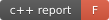

# C++ Report Card snapshot

[English](README.md) | [简体中文](README.zh-CN.md)

This SVG is the unmodified artifact from the successful
[full ARM64 report](https://github.com/soulteary/linkerbot-hand-cpp-sdk/actions/runs/41663452602)
for PR head `26912797fe297bafdd8be40cab09e2a847221c60`, using C++ Report Card Action
v1.0.2 at `9458d052f286c576d557c34d8ad43096cedbf561`.

- Analysis complete: `true`; grade: **F**; score: **59/100**.
- clang-format: **579/579 files**, 12 diagnostics.
- Cppcheck: **341/341 compilation entries**, 26 diagnostics.
- clang-tidy: **341/341 compilation entries**, 679 diagnostics.

The score is a source-analysis baseline, not test coverage or hardware validation.
Diagnostics require review; they are not all confirmed defects. The current gate
requires complete analysis and preserves findings, so a successful workflow does
not imply a zero-diagnostic report.

The README score badge is this dated snapshot; the adjacent CI badge shows the
latest main-branch workflow status. Download the run's
`cppreportcard-ubuntu-24.04-arm` artifact for the original JSON, Markdown, SVG and
compilation database. New runs upload artifacts without committing them automatically.
Refresh the SVG, source commit, run link and counts together from a completed run.
See the [quality guide](../../docs/en/guides/quality.md) for scope and policy.
